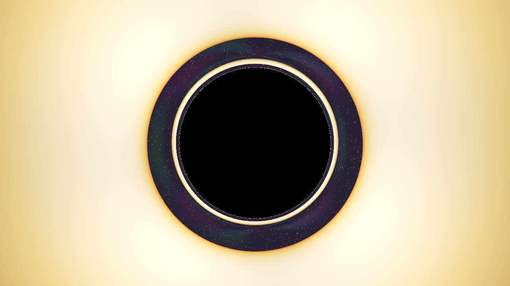

# Schwarzschild Black-Hole Ray Tracer

A C++17 renderer and numerical simulator that integrates null geodesics (light paths) in Schwarzschild spacetime. It produces the gravitational lensing of a star field, the black-hole shadow and photon ring, a geometrically thin accretion disk bent around the hole, and the relativistic beaming that makes one side of that disk flare and the other dim.

[](https://github.com/rishabhpahade/blackhole-raytracer/actions/workflows/build-and-test.yml)



*What you are looking at: the black disc is the shadow — rays that crossed the event horizon. The thin bright ring hugging it is the photon sphere, where light can orbit the hole. The disk's far side has been lensed up and over the shadow into an arc. The left side is brighter and whiter than the right because that gas is orbiting toward the camera; the right side is receding and redshifted.*

---

## Features

- **Null geodesics** integrated in 3D Cartesian form, with no coordinate singularities at the poles.
- **RK4 with curvature-adaptive stepping** — small steps near the photon sphere, large ones in the weak field.
- **Thin accretion disk** with a Page–Thorne temperature profile, inner edge at the ISCO, and a Keplerian orbital velocity field.
- **Relativistic beaming and gravitational redshift** — observed temperature scales as $gT$, intensity as $g^4$.
- **Physically derived anti-aliasing** via Halton sub-pixel jitter (any samples-per-pixel count keeps improving).
- **ACES filmic tone mapping** so highlights roll off instead of clipping to flat white.
- **Diagnostics as first-class output**: a false-colour ray-classification map, a deflection-vs-impact-parameter dataset, and a metrics report.
- **25-assertion scientific test suite** checked against closed-form general relativity, run on every push.

---

## 1. Physical Model

### Spacetime Metric
The geometry around a static, uncharged spherical mass $M$ in geometrized units ($G = c = 1$) is the **Schwarzschild metric**:

$$ds^2 = -\left(1 - \frac{2M}{r}\right)dt^2 + \left(1 - \frac{2M}{r}\right)^{-1}dr^2 + r^2 d\theta^2 + r^2 \sin^2\theta\, d\phi^2$$

### Null Geodesic Equation of Motion
Light follows null geodesics, $ds^2 = 0$. Spherical symmetry makes every photon orbit planar, with conserved specific energy $E = (1 - 2M/r)\dot{t}$ and angular momentum $\mathbf{L} = \mathbf{r} \times \dot{\mathbf{r}}$.

In orbital coordinates $(u, \phi)$ with $u = 1/r$:

$$\frac{d^2u}{d\phi^2} + u = 3Mu^2$$

The nonlinear term $3Mu^2$ is the origin of general-relativistic light bending. In 3D Cartesian coordinates with $\mathbf{x} = (x, y, z)$ and spatial wavevector $\mathbf{v} = \dot{\mathbf{x}}$:

$$\ddot{\mathbf{x}} = -\frac{3M\,|\mathbf{x} \times \mathbf{v}|^2}{|\mathbf{x}|^5}\,\mathbf{x} = -\frac{3M L^2}{r^5}\,\mathbf{x}$$

This form guarantees:

1. **Strict angular-momentum conservation**: $\frac{d}{d\lambda}(\mathbf{x} \times \mathbf{v}) = \mathbf{x} \times \ddot{\mathbf{x}} = \mathbf{0}$.
2. **No coordinate singularities**: nothing blows up at the polar axes ($\theta = 0, \pi$).

### Critical Physical Radii
- **Event horizon**: $r_h = 2M$. Any ray crossing $r \le 2M$ cannot escape; this is the shadow.
- **Photon sphere**: $r_{\text{ph}} = 3M$, the unstable circular photon orbit.
- **Critical impact parameter**: $b_c = 3\sqrt{3}M \approx 5.19615M$. Rays with $b < b_c$ plunge through the horizon, rays with $b > b_c$ escape to infinity.
- **Weak-field deflection**: for $b \gg 3M$ the scattering angle approaches Einstein's $\alpha(b) \approx 4M/b$, with the second-order term $\frac{15\pi}{4}\frac{M^2}{b^2}$ used in the tests.

### Accretion Disk
The disk is an optically emitting, geometrically thin plane at $z = 0$, bounded by $r_{\text{inner}} = 6M$ (the ISCO) and $r_{\text{outer}} = 22M$. Its temperature follows the standard thin-disk (Page–Thorne / Shakura–Sunyaev) profile:

$$T(r) \propto r^{-3/4}\left(1 - \sqrt{\frac{r_{\text{in}}}{r}}\right)^{1/4}$$

The emitted spectrum is graded to RGB along a Planckian colour ramp.

### Relativistic Beaming and Gravitational Redshift
The disk image is frequency-shifted as well as lensed. For matter on a circular Keplerian orbit:

$$g = \frac{\nu_{\text{obs}}}{\nu_{\text{em}}} = \frac{\sqrt{1 - 2M/r}}{\gamma\left(1 - \boldsymbol{\beta}\cdot\hat{\mathbf{d}}\right)},\qquad \beta = \frac{\sqrt{M/r}}{\sqrt{1 - 2M/r}},\qquad \gamma = \frac{1}{\sqrt{1-\beta^2}}$$

where $\hat{\mathbf{d}}$ is the photon's direction of travel toward the observer. A radially outgoing photon ($\boldsymbol{\beta}\cdot\hat{\mathbf{d}} = 0$) reduces to the standard $g = \sqrt{1-3M/r}$ for a circular orbit.

Two consequences: the observed temperature scales as $gT$, so gas approaching the observer is bluer; and the bolometric intensity scales as $g^4$ (specific intensity $I_\nu/\nu^3$ is invariant), so at $r = 8M$ the approaching side is about $32\times$ brighter than the receding side. Set `enableDopplerBeaming = false` to disable the shift.

---

## 2. Numerical Method

Each ray is a 6D phase-space state $\mathbf{s} = (\mathbf{x}, \mathbf{v})$ advanced with classical **Runge–Kutta 4**. The derivative is the geodesic field itself, $\dot{\mathbf{s}} = (\mathbf{v}, \mathbf{a}(\mathbf{x}, \mathbf{v}))$.

**Step control.** The step is piecewise in radius:

- **Strong field** ($r < 2r_{\text{ph}}$): scaled by the distance to the horizon, floored at 5% of the base step, so tight orbits around the photon sphere are resolved.
- **Weak field**: grows roughly proportionally to $r$, because the local radius of curvature grows with $r$. This is what keeps the long approach from the camera and the exit to the escape sphere cheap — average 186 steps per ray instead of 1061 at the same accuracy.

**Termination.** A ray ends as `Captured` (inside $2M(1+\epsilon)$), `HitAccretionDisk` (crossing $z=0$ within the annulus, plane-crossing solved by linear interpolation inside the step), `Escaped` ($r \ge r_{\text{escape}}$ and moving outward), `MaximumStepsReached`, or `NumericalFailure` (non-finite state).

**Shading.** Disk hits use the emitted spectrum shifted by $g$; escaping rays sample a procedural starfield along their asymptotic direction; captured rays are black.

**Tone mapping.** Linear light is exposed, mapped through the ACES filmic curve, then gamma-encoded to sRGB. The curve's shoulder is what keeps the $g^4$ dynamic range visible instead of clipping the disk to cream.

---

## 3. Software Architecture

```
blackhole_raytracer/
├── include/
│   ├── Vector3.hpp              # 3D vector algebra, operators, dot/cross, safety guards
│   ├── Camera.hpp               # Pinhole camera, orthonormal basis, sub-pixel sampling
│   ├── BlackHole.hpp            # Mass, horizon, photon sphere, ISCO, capture test
│   ├── Ray.hpp                  # 6D ray state, RayStatus, redshift, deflection metric
│   ├── GeodesicIntegrator.hpp   # RK4 + adaptive step + redshift factor
│   ├── AccretionDisk.hpp        # Disk geometry, temperature profile, beamed colour
│   └── Renderer.hpp             # Pixel loop, OpenMP, tone mapping, PNG, CSV, metrics
├── src/
│   ├── Camera.cpp
│   ├── AccretionDisk.cpp
│   ├── GeodesicIntegrator.cpp
│   ├── Renderer.cpp
│   └── main.cpp                 # Scene configuration and run
├── external/
│   └── stb_image_write.h        # Self-contained PNG writer
├── tests/
│   └── validation_tests.cpp     # 25 scientific assertions
├── .github/workflows/           # CI: configure, build, ctest
├── output/                      # Generated deliverables
├── CMakeLists.txt
└── README.md
```

| Module | Responsibility |
|---|---|
| `Vector3` | Value-type 3D algebra. Normalization and division guard near-zero magnitudes. |
| `Camera` | Generates one ray per (sub)pixel. Falls back to another axis if the reference up vector is degenerate. |
| `BlackHole` | Characteristic radii and the horizon test. |
| `Ray` | Mutable ray state plus the measured deflection and redshift. |
| `GeodesicIntegrator` | The integrator, its step policy, termination logic, and the redshift factor. |
| `AccretionDisk` | Plane-crossing detection, temperature profile, colour, $g^4$ beaming. |
| `Renderer` | Parallel pixel loop, background, tone mapping, all file output. |

---

## 4. Build

### Prerequisites
- A C++17 compiler (`g++`, `clang++`, or MSVC)
- CMake 3.14+ (optional — direct compiler commands work too)
- OpenMP (optional; without it the renderer runs single-threaded)

### Option A — direct with GCC / MinGW

```bash
# Renderer
g++ -std=c++17 -O3 -fno-math-errno -fopenmp -Iinclude -I. \
    src/Camera.cpp src/AccretionDisk.cpp src/GeodesicIntegrator.cpp src/Renderer.cpp src/main.cpp \
    -o blackhole_raytracer.exe

# Test suite
g++ -std=c++17 -O3 -fno-math-errno -fopenmp -Iinclude -I. \
    src/Camera.cpp src/AccretionDisk.cpp src/GeodesicIntegrator.cpp src/Renderer.cpp tests/validation_tests.cpp \
    -o validation_tests.exe
```

### Option B — CMake

```bash
cmake -S . -B build -DCMAKE_BUILD_TYPE=Release
cmake --build build --parallel
ctest --test-dir build --output-on-failure
```

> **Do not add `-ffast-math` (or MSVC `/fp:fast`).** It implies finite-math-only, which lets the compiler fold `std::isfinite()` to `true` and silently disables the `NumericalFailure` guard. Verified: under those flags `isfinite(NaN)` evaluates to `1`.

---

## 5. Running

```bash
# Scientific validation suite — 25 assertions
./validation_tests.exe

# <width> <height> <samples-per-pixel>; defaults are 1280x720 at 2 spp
./blackhole_raytracer.exe 1280 720 2
```

### Camera and Exposure
The disk lies in the `z = 0` plane, so the camera's `|z|` is its height above the disk and `|(x, y)|` is its in-plane distance. The default view sits 15° above the plane at 56M with `+z` as the image's up axis — shallow enough that the far side of the disk is lensed over the shadow. Reframe with `inclinationDegrees`, `orbitRadius` and `fov` in `src/main.cpp`; brightness is `renderer.exposure`, tuned against the ACES curve.

Keep the escape sphere well outside the camera (`escapeRadius` defaults to 120M): the background is sampled from there, so a ray that leaves near the observer would otherwise use a direction that has not yet reached its asymptotic value.

### Outputs
1. **`black_hole.png`** — the visual render: shadow, photon ring, lensed disk, starfield.
2. **`ray_classification.png`** — false-colour diagnostic map, one colour per `RayStatus`:
   **black** captured by the horizon, **amber** disk hit, **electric blue** escaped to infinity, **grey** maximum steps, **magenta** numerical failure.
3. **`deflection_vs_impact_parameter.csv`** — $\alpha(b)$ for 600 impact parameters between 3M and 50M, next to the Einstein prediction. Rows carry a `Status` column: below $b_c$ the ray is captured and its "deflection" is not a scattering angle, so filter on `Status == Escaped` before comparing to theory.
4. **`simulation_metrics.txt`** — resolution, timing, throughput, the ray-classification breakdown, and integration-depth statistics.

Typical run: 1280×720 at 2 spp on 8 cores renders in about 11 seconds, roughly 83k pixel-rays/s, averaging 186 integrator steps per ray. Zero numerical failures on the default scene.

---

## 6. Validation

All 25 assertions in `tests/validation_tests.cpp` pass; the numbers below are printed by that suite, not copied from an older revision.

| Test case | Theory | Measured | Status |
|---|---|---|---|
| Horizon capture radius | $r \le 2.000M$ | $r \le 2.002M$ | **PASS** |
| Critical impact parameter (bisection) | $b_c = 3\sqrt{3}M = 5.196152M$ | $5.196135M$ — relative error $3.4\times10^{-6}$ | **PASS** |
| Weak-field deflection, $b = 50M$ | $\alpha = 0.084712$ rad | $0.085081$ rad — $0.44\%$ | **PASS** |
| Weak-field deflection, $b = 100M$ | $\alpha = 0.041178$ rad | $0.041209$ rad — $0.08\%$ | **PASS** |
| Weak-field deflection, $b = 150M$ | $\alpha = 0.027190$ rad | $0.027163$ rad — $0.10\%$ | **PASS** |
| Axisymmetry / reflection symmetry | $\Delta\alpha = 0$ | $\Delta\alpha < 10^{-10}$ rad | **PASS** |
| RK4 convergence order | $\mathcal{O}(h^4)$, order $\approx 4$ | observed $3.98$ and $3.55$ | **PASS** |
| Radial redshift, $r = 10M$ | $g = \sqrt{1-3M/r} = 0.836660$ | $0.836660$ — exact to $10^{-12}$ | **PASS** |
| Doppler shift at the ISCO, prograde | $g = 1.414214$ | $1.414214$ — exact to $10^{-12}$ | **PASS** |
| Doppler shift at the ISCO, retrograde | $g = 0.471405$ | $0.471405$ — exact to $10^{-12}$ | **PASS** |
| $g^4$ beaming contrast, $r = 8M$ | approaching side $\sim32\times$ brighter | $32.1\times$ | **PASS** |

Beyond the table, the suite also checks horizon capture of a radial ray, sub- and super-critical ray fate, disk-plane crossing with inward bending, and that disk emission stays finite.

---

## 7. Numerical Safeguards

1. **Near-singularity proximity** — inside $r \le 2M(1+\epsilon)$ a ray is classified `Captured` before it can reach $r = 0$.
2. **Division-by-zero protection** — normalization and scalar division guard against near-zero magnitudes.
3. **Non-finite detection** — every step checks the state; NaN or infinity ends the ray as `NumericalFailure` (see the build note in §4).
4. **Adaptive stepping** — see §2.
5. **Degenerate camera basis** — a reference up vector parallel to the view direction is replaced by another axis instead of collapsing the basis to zeros.

---

## 8. Limitations and Roadmap

Honest scope, so nobody has to reverse-engineer it from the code:

- **No spin.** The metric is Schwarzschild; there is no frame dragging, no ergosphere, no Kerr shadow asymmetry. Adding spin needs a Kerr integrator and Hamiltonian formulation — a project, not a patch.
- **Beaming direction is approximate.** $\hat{\mathbf{d}}$ is taken from the coordinate velocity rather than being transformed into the static observer's orthonormal frame. This is a few-percent error in the tangential component at small radii, where the disk is already strongly lensed.
- **Thin, steady disk.** No vertical structure, no radiative transfer, no polarization, no time dependence; the temperature ramp is a fit, not a Planck integral through a filter.
- **CPU only.** OpenMP over pixels; a GPU port (CUDA/Compute) would give 100× and is the obvious next step for high-spp or animation work.
- **Fixed-step RK4.** A Dormand–Prince RK45 with a local error tolerance would replace the heuristic step policy with a controlled one.

---

## 9. References

- K. Schwarzschild, *Über das Gravitationsfeld eines Massenpunktes* (1916).
- J.-P. Luminet, *Image of a spherical black hole with thin accretion disk*, A&A 75 (1979).
- D. N. Page & K. S. Thorne, *Disk-accretion onto a black hole*, ApJ 191 (1974).
- C. T. Cunningham & J. M. Bardeen, *The optical appearance of a star orbiting an extreme Kerr black hole*, ApJ 183 (1973).
- ACES filmic tone curve, Narkowicz fit.
